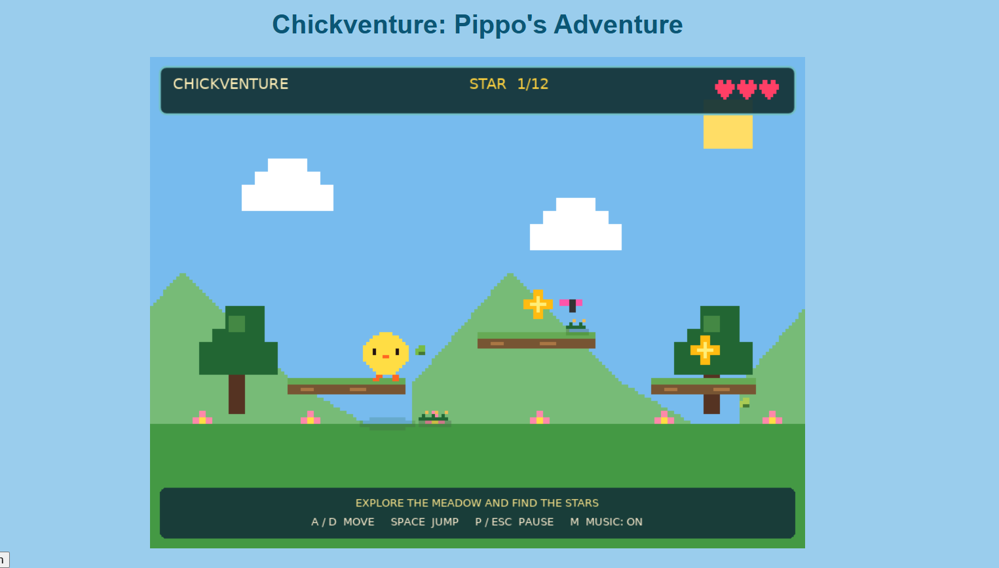
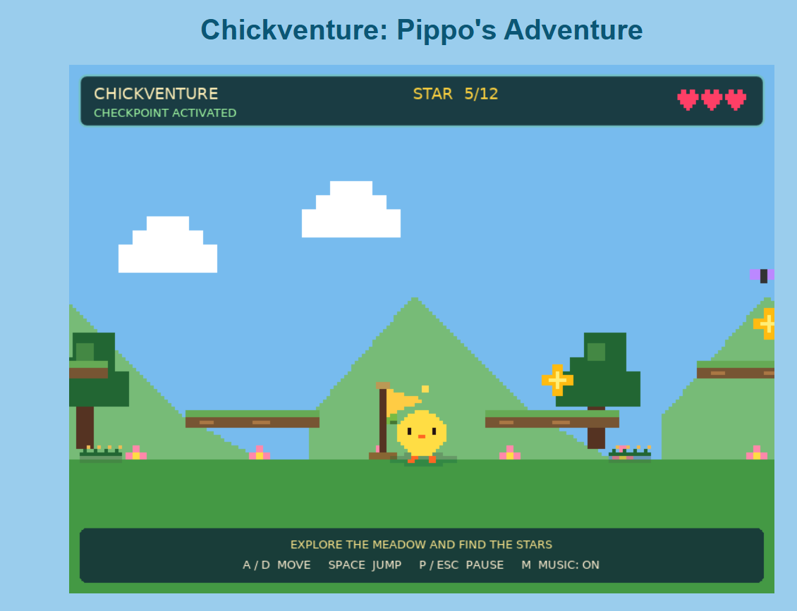
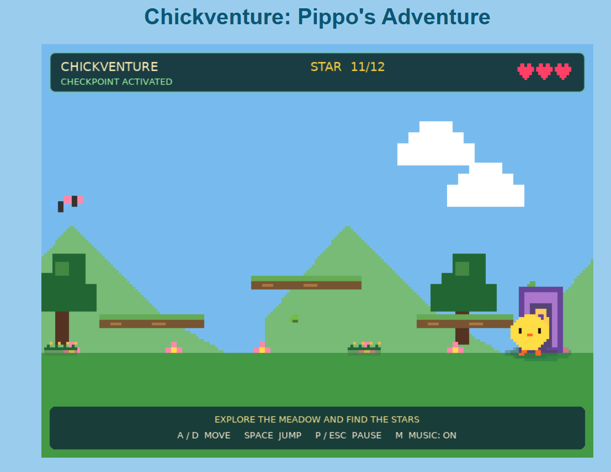

# 🐥 Chickventure: Pippo's Adventure

*A little chick, a big adventure.*

Welcome to **Chickventure**, a small and cozy 2D platformer game made with **Lua and LÖVE2D**.

Meet Pippo, a tiny chick exploring a colourful world, collecting stars and making his way through a little adventure. ✨

## 🎮 Play the Game

**[🐥 Play Chickventure in Your Browser](https://stigmaniac.github.io/chickventure/)**

## 📸 Gameplay






No installation needed. Just open and play!

## 🕹️ Controls

| Key | Action |
|---|---|
| A / D | Move left / right |
| W | Move up |
| Space | Jump |

## 🌱 About the Project

Chickventure is my first independently built game project.

I created it while learning Lua and experimenting with the LÖVE2D game framework. It started as a simple idea and slowly turned into Pippo's little adventure.

## 🛠️ Built With

- Lua
- LÖVE2D
- love.js
- GitHub Pages

## 🚀 Run Locally

1. Install [LÖVE2D](https://love2d.org/).
2. Clone this repository:

   ```bash
   git clone https://github.com/stigmaniac/chickventure.git
   ```

3. Open the project folder.
4. Run it with LÖVE2D.

## 💛 A Little Note

This project is a part of my learning journey. There is still plenty to explore, improve and add.

Thanks for stopping by. Say hi to Pippo! 🐥

---

**Made with curiosity, Lua, and a tiny chick.**
